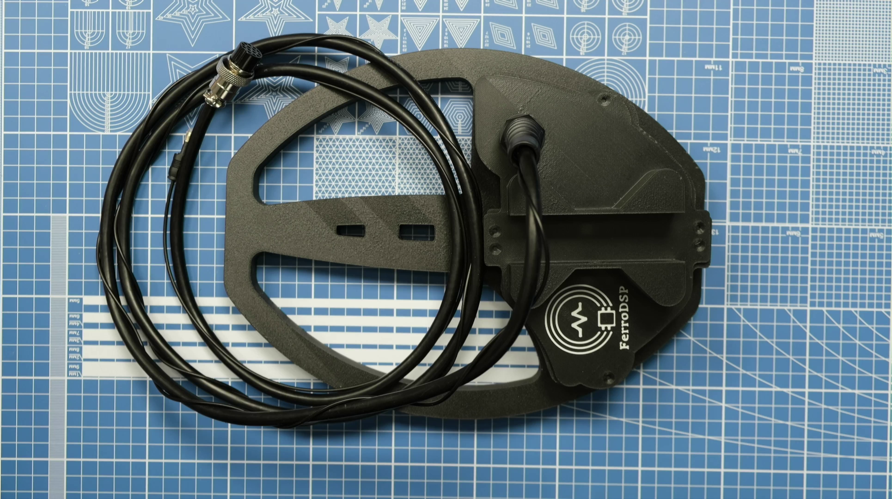
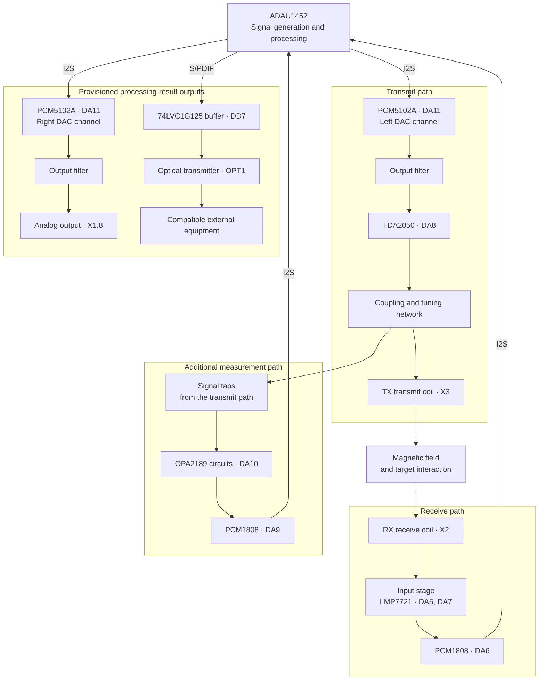
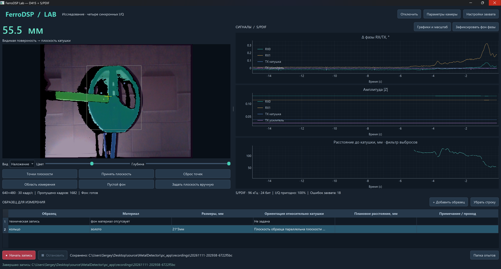
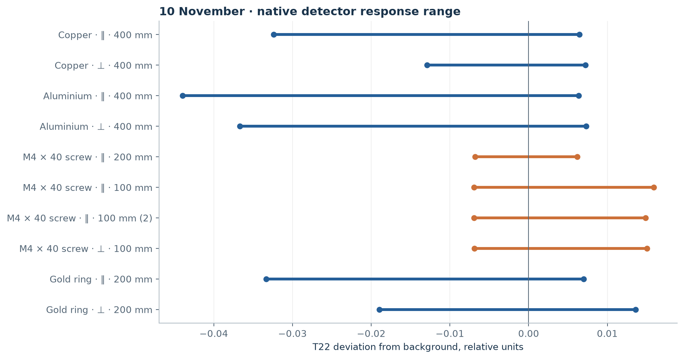
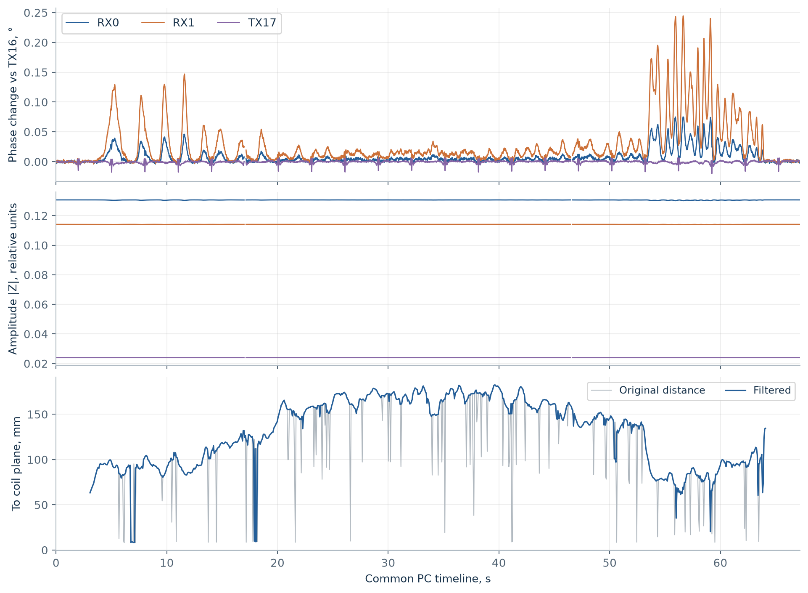
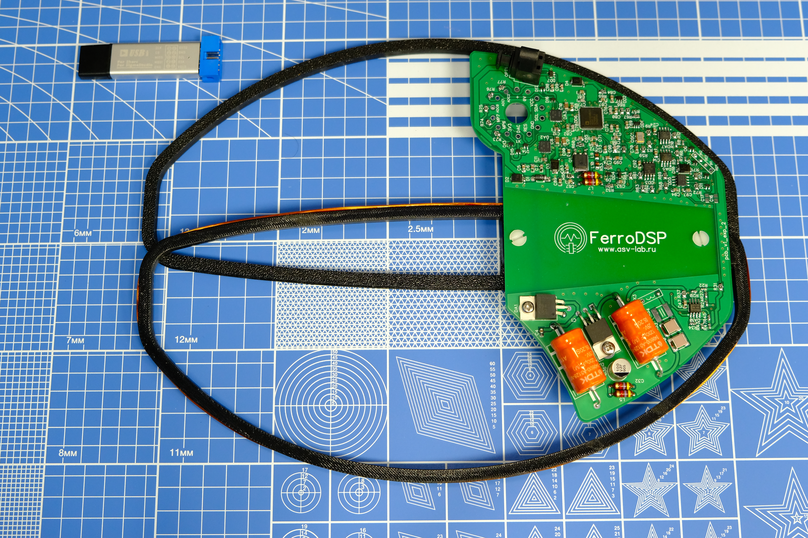
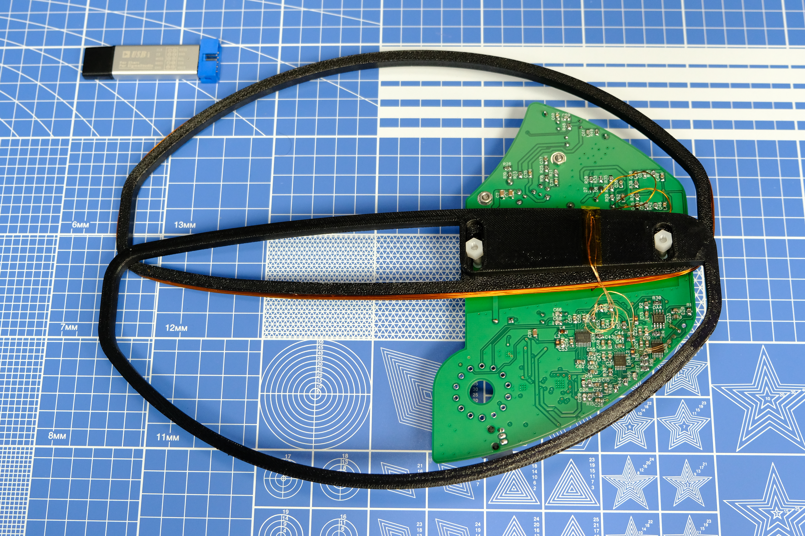

# FerroDSP

[Русский](README.md) | English

**Experimental metal detector based on the ADAU1452 audio processor.**

FerroDSP uses an audio DSP to investigate search-head signals. Custom electronics, SigmaStudio algorithms and 3D-printable parts form a platform for experiments with coil excitation, reception and response processing.



*Assembled search head. Photographs of the internal construction are [below](#prototype-photographs).*

> The project is experimental. The materials include an assembled prototype and DSP project compilation results; quantitative detection performance still needs to be confirmed by measurements.

## Contents

- [What makes the project distinctive](#what-makes-the-project-distinctive)
- [Block diagram](#block-diagram)
- [Architecture and capabilities](#architecture-and-capabilities)
- [FerroDSP coils — DD construction](#ferrodsp-coils--dd-construction)
- [PC laboratory](#ferrodsp-lab--pc-laboratory)
- [Bench measurements](#bench-measurements-1011-november-2026)
- [Two working SigmaStudio projects](#two-working-sigmastudio-projects)
- [Prototype photographs](#prototype-photographs)
- [Project materials](#project-materials)
- [Continuing development with AI](#continuing-development-with-ai)
- [Current status](#current-status)

## What makes the project distinctive

Several choices give FerroDSP its character:

- **ADAU1452 in the measurement path.** The processor generates and processes metal-detector signals.
- **Algorithms in SigmaStudio.** The block graph lets us investigate and modify processing on the same hardware.
- **Electronics directly inside the search head.** Board and coils form one assembly.
- **Several digitization channels.** The design receives signals from both the receive coil and transmit-path circuits.
- **Continued development with AI.** The project materials provide a basis for understanding the device, preparing hypotheses and conducting verifiable experiments.

The saved DSP project includes oscillators, FIR and other filters, Hilbert transforms, adjustable delay, envelope detectors and output-signal blocks. These provide a basis for investigating the response's amplitude and phase characteristics and ways to represent it as sound.

The project may interest home-built metal-detector developers, electronics enthusiasts, SigmaStudio users and people studying digital signal processing on real hardware.

## Block diagram

The diagram shows the main hardware routes from the [electrical schematic](схема_плата/схема.pdf). Solid arrows represent electrical signal connections; dashed arrows represent interaction through the magnetic field. Power, protection, clocking and control circuits are omitted.



TX and RX couple through the magnetic field. The additional measurement path receives signals from several points in the transmit circuit; the tap block is generalized in this diagram. OPA2189 (DA4.1) also helps generate the receive path's reference level.

The left and right DAC channels in the diagram belong to the same DA11 IC. Signal generation and processing take place within one ADAU1452. The purpose of output data and the indication method depend on the DSP configuration and connected equipment.

This is a hardware block diagram, not a map of SigmaStudio block connections or confirmation that every path works. The optical interface's status is described [separately](#optical-digital-output).

## Architecture and capabilities

### Adjustable digital processing

SigmaStudio lets us modify processing structure, filtering, gain, delays and signal generation. Within the analog path's and processor's capabilities, many experiments can use the same board.

The graphical representation helps us view the algorithm as a sequence of connected functional blocks and compare changes with search-head behavior.

### Electronics beside the coils

The board is mounted directly inside the search-head assembly. This shortens the weak analog signal path from the receive coil to the input electronics and provides an opportunity to reduce the influence of a long analog cable.

The mechanical and electronic designs were developed together. The improvement in stability for a particular unit needs to be evaluated through measurements.

### Digitizing receive and reference signals

The schematic uses two PCM1808 ADCs: DA6 serves the receive-coil input path, and DA9 connects to transmit-path circuits. They provide a basis for signal comparison and experiments with reference-based processing.

Specific compensation and target-recognition capabilities depend on the algorithm and adjustment.

### Analog path

The receive path uses LMP7721 and OPA2189; several circuits specify resistors with 0.01% tolerance. The design includes linear regulators, supply filtering, decoupling capacitors and protection components. A TDA2050 amplifier drives the transmit coil from a PCM5102A DAC signal.

This is a developed basis for adjustment and measurement. Actual noise, drift and sensitivity also depend on the board, assembly, coils and operating conditions.

### Optical digital output

In the electrical schematic, the processor's S/PDIF output connects through a buffer to an optical transmitter. The saved compiler report includes S/PDIF output blocks.

Experiments on 10–11 November 2026 verified optical capture through a Sound Blaster G3. A new project transports I/Q from four inputs over two S/PDIF channels: complex envelopes, not four full-band ADC streams. [FerroDSP Lab](pc_app/QUICKSTART.en.md) displays the signals alongside a D415 depth camera and records combined trials. The [measurement report](docs/measurements/2026-11-10_11/README.en.md) includes observed frame gaps; hardware synchronization between camera and audio is not claimed.

### DSP resource margin

The saved [compilation report](сигма_проект/Ferrodsp_v1_exp2/Ferrodsp_v1_exp2_IC%201/compiler_output.log), dated 7 February 2026, gives these estimates:

| Parameter | Value |
| --- | --- |
| Sample rate | 96 kHz |
| Cycle utilization | About 39% |
| Program memory used | About 22% |
| Data memory used, DM0 / DM1 | About 6% / 3% |
| Compilation result | 0 errors, 0 warnings |

According to that report, the configuration leaves room for processing development. These values are compiler estimates for the saved build; resource use must be checked again after modifications.

### Electronics and mechanics in one package

The project includes the schematic, component list, PCB Gerber files, SigmaStudio project, compilation results and prototype photographs. Enclosure and coil-former models are provided in STL, STEP and M3D. STL supports printing; STEP supports adapting the design in CAD.

## FerroDSP coils — DD construction

The search head uses a **DD** construction. The **TX transmit coil connects to X3**, and **RX connects to X2**. RX consists of two halves with a center tap.

### Coil parameters

| Parameter | Transmit TX | Receive RX, L1 | Receive RX, L2 |
| --- | --- | --- | --- |
| Wire diameter | 0.45 mm | 0.15 mm | 0.15 mm |
| Turns | 45 | 100 | 100 |
| Resistance | 2.4 Ω | 63 Ω | 67.9 Ω |
| Inductance | 787 µH | 5.495 mH | 6.388 mH |
| Quality factor Q | 16.3 | 4.92 | 5.25 |

The author reported these parameters for the particular unit. The frequency and conditions used to measure inductance and Q have not yet been supplied. L1 and L2 in this table identify the RX halves, not PCB component designators. Former models are in the [enclosure directory](корпус/).

### Transmit-coil resonance

Two parallel **68 nF capacitors, C33 and C34**, give a total of **136 nF**. With TX inductance **787 µH**, the ideal LC formula gives:

```text
C = C33 + C34 = 136 nF
f₀ = 1 / (2π√(LC)) ≈ 15 384 Hz ≈ 15.38 kHz
```

The calculation assumes no additional **C30** capacitance. This is a calculated resonant frequency; experiments on 10–11 November used a 15.2 kHz generator. Selecting this frequency does not replace a separate measurement of loaded resonance and quality factor.

The author observed **about 120 V peak-to-peak (Vpp)** across TX at resonance. This is the voltage swing, not an RMS value.

### Balancing

Correct balancing affects sensitivity and discrimination — distinguishing metals by their phase response. The author described the following method for the particular unit:

1. Connect the two oscilloscope probes to the outer RX terminals and the channels' ground leads to the center tap.
2. Move RX relative to TX while observing the phase relationship of the two signals.
3. Find a position with opposite-phase signals.
4. Bring metal near and observe amplitude decreasing in one RX half and increasing in the other.

Before connection, account for the oscilloscope channels' common ground: the RX center tap must permit connection to instrument ground. TX voltage measurement requires a probe and connection method rated for that voltage. Connecting common ground to an arbitrary transmit-circuit point can short it to earth.

This is an account of the author's practice. Initial bench observations are documented in the [report](docs/measurements/2026-11-10_11/README.en.md); quantitative sensitivity and discrimination criteria remain unverified, and opposite-phase signals alone do not establish detection performance.

## FerroDSP Lab — PC laboratory

[Download portable Windows x64](https://github.com/neuroandriyanov/FerroDsp/releases/tag/lab-v0.1.0-preview.1) · [Instructions](pc_app/QUICKSTART.en.md) · [Source code](pc_app/) · [MP4 demonstration](https://media.neuroandriyanov.com/demonstration_ferrodsp_lab.mp4)

FerroDSP Lab combines D415 color and depth with phase, amplitude and distance plots. It provides adjustable image overlays, camera and capture settings, channel and scale selection, a target table and joint recording. Analysis data includes PCM, numeric Z16 depth, RGB, I/Q, timestamps and quality masks. Demonstration exports are H.264 MP4 files with the target name and plots on the right.



*Working-interface screenshot supplied by the author. Error counters are cumulative for the session; each recording is assessed using its own log and masks. The current application UI is Russian.*

The portable ZIP includes Python, Qt, the RealSense SDK, libraries and FFmpeg: extract the entire archive and run `FerroDSP-Lab.exe`. These components do not require separate installation. Windows 10/11 x64 and device drivers are required. Settings and recordings go into `UserData`; calibrate camera geometry for your own setup. The application does not modify DSP or EEPROM; a metal classifier is not implemented yet.

### Laboratory equipment

| Purpose | Device and manufacturer | Trial configuration |
| --- | --- | --- |
| Color and depth | **Intel RealSense D415**, active stereo camera | USB 3, 640 × 480; ring recording on 11 November at 15 fps |
| Optical audio capture | **Creative Sound Blaster G3**, Creative Technology | S/PDIF IN, WASAPI exclusive, 96 kHz, stereo PCM24 |
| In-coil processing | **ADAU1452**, Analog Devices | SigmaStudio 4.7, DSP 96 kHz, 15.2 kHz excitation |
| Analog converters | **PCM1808 × 2, PCM5102A**, Texas Instruments | Two RX and two transmit-path signals |
| Transmit amplifier | **TDA2050**, STMicroelectronics | PC Stream digital generator level −18 dB |
| DSP configuration | **USBi**, SigmaStudio interface | Manufacturer of the particular adapter unconfirmed |

No separate video capture card is required: the D415 sends images over USB. PCM24 denotes the recording format; the G3 input's effective resolution was not measured. Manufacturer documentation and clocking notes are included in the [measurement description](docs/measurements/2026-11-10_11/README.en.md#equipment-and-sources).

## Bench measurements: 10–11 November 2026

[English PDF report](docs/measurements/2026-11-10_11/FerroDSP-bench-2026-11-10_11.en.pdf) · [Methods, numeric data and plotting script](docs/measurements/2026-11-10_11/README.en.md) · [Russian report](docs/measurements/2026-11-10_11/FerroDSP-bench-2026-11-10_11.ru.pdf)

The coil is horizontal, approximately 650 mm above a wooden floor over reinforced concrete. Copper and aluminium foil, an M4 × 40 mm screw, a gold ring and a steel plate were tested in different orientations. Distances on 10 November were operator estimates; these trials do not establish maximum detection depth.



*The native T22 output is in relative units, not degrees. ∥ / ⊥ indicate the target plane, or the screw axis, relative to the coil plane. Segments show minima and maxima, not confidence intervals.*



*11 November: 21 × 3 mm ring, plane parallel to the coil; 6715 I/Q sets, 99.4937% valid, 999 camera frames. Distance refers to the nearest visible foreground surface, which may be a hand or holder. Physical camera-to-audio latency has not been calibrated.*

RX0/RX1 interchannel phase did not provide a universal sign rule to separate steel from nonferrous metals. All four complex inputs, including the transmit reference, are therefore retained for the next stage. The report includes limitations and rejected intervals; classification, size and depth accuracy still require testing with unseen objects.

## Two working SigmaStudio projects

[Operating modes and build verification](сигма_проект/README.en.md)

| Project | Purpose | Saved settings |
| --- | --- | --- |
| [FerroDSP Phase Tracking](сигма_проект/FerroDSP_Phase_Tracking/FerroDSP_Phase_Tracking.dspproj) | Initial balancing and slow phase tracking around zero | 15.2 kHz; TX −30 dB; native T22 and audio path |
| [FerroDSP PC Stream](сигма_проект/FerroDSP_PC_Stream/FerroDSP_PC_Stream.dspproj) | Four complex channels to FerroDSP Lab over S/PDIF | 15.2 kHz; TX −18 dB; `PC_Mode=1`, `ferrodsp-am-iq-v1`; audio output muted |

Blocks in both projects are arranged by functional signal paths. These are alternative configurations: the Phase Tracking stream is incompatible with the PC Stream decoder. In the second project, balancing and feature research run on the PC; transmitted values are complex envelopes, not four full-bandwidth ADC streams.

## Prototype photographs

### Board and coils



*Electronics placed directly in the search head.*

### Underside and assembly



*Internal construction of the experimental unit.*

## Project materials

| Directory or file | Contents |
| --- | --- |
| [SigmaStudio project](сигма_проект/Ferrodsp_v1_exp2/Ferrodsp_v1_exp2.dspproj) | Original Ferrodsp_v1_exp2 algorithm graph |
| [Compilation outputs](сигма_проект/Ferrodsp_v1_exp2/Ferrodsp_v1_exp2_IC%201/) | Program, parameters and resource report |
| [Electrical schematic](схема_плата/схема.pdf) | Six schematic pages; [English annotations](docs/HARDWARE-ANNOTATIONS.en.md) |
| [English component list](схема_плата/specificationsmd.en.xlsx) | Components and designators; [original and translation notes](docs/HARDWARE-ANNOTATIONS.en.md#component-workbook) |
| [Board manufacturing files](схема_плата/FerroDSP_EXP2_V1.zip) | Gerber and drill archive |
| [Mechanical design](корпус/) | Search-head enclosure and TX/RX formers in STL, STEP and M3D |
| [Photographs](фото/) | Assembled search head and internal construction |

## Continuing development with AI

One of FerroDSP's central ideas is joint human–AI work on a real device. Project materials supply context for discussing the schematic, algorithms and mechanics. AI can help explain the device and prepare calculations, analysis scripts and documentation; the quality of changes is judged by experiment results.

### 1. Open the materials

Open the repository root as a local project in Codex. Start with the README, schematic and compiler reports, then choose the path you want to investigate.

| Source | How to use it |
| --- | --- |
| `схема_плата/схема.pdf` | Inspect visually: extracted text reveals almost none of the connections |
| `схема_плата/specificationsmd.en.xlsx` | Match components and designators to the schematic; original `specificationsmd.xlsx` is retained |
| `сигма_проект/Ferrodsp_v1_exp2/Ferrodsp_v1_exp2.dspproj` | Open in SigmaStudio; the saved files correspond to version 4.7 |
| `compiler_output.log` in the compilation-output directory | Check build result and resource estimates |
| `ParamAddress.dat` in the same directory | Inspect parameter addresses |
| `фото/` and `корпус/` | Investigate assembly, layout and search-head construction |

`.dspproj` is binary: extracting individual strings does not replace viewing the graph. To analyze a particular path with AI, provide a screenshot of the relevant SigmaStudio section and block parameter values. Edit the source project and recompile; `Program.bin` and other output files are build results.

### 2. Prepare a first experiment

For example, investigate one receive-path filter parameter. First trace the block's connections in SigmaStudio and establish its function. Work with a project copy, preserving the original for comparison.

Example task for Codex:

```text
Study README.en.md, the electrical schematic and the reports in
сигма_проект/Ferrodsp_v1_exp2/Ferrodsp_v1_exp2_IC 1.

Separate confirmed facts from assumptions. Help prepare an experiment
with one receive-path filter parameter: which connections and settings
to show from SigmaStudio, what to change and which measurements to compare.

For the binary .dspproj, use a screenshot of the relevant section
and parameter values. First prepare a plan without changing files.
```

### 3. Change, measure, compare

1. Record the project version, starting settings, target, distance and position relative to the search head, gain and recording method.
2. Take a baseline measurement. If optical recording is planned, first check the interface separately with the selected receiver.
3. Change one parameter, compile in SigmaStudio, and check errors and resource use.
4. After loading, repeat the measurement under the same conditions. Compare response, background and repeatability.
5. Save settings, measurements and a short conclusion, including experiments that did not improve the result.

Each experiment thus has a clear basis: **hypothesis → one change → measurement → result**. DSP, analog electronics and mechanics can be developed separately while preserving the project's shared context.

Reference: [local projects and chats in Codex](https://learn.chatgpt.com/docs/projects).

## Current status

| Available materials | Still to document or verify |
| --- | --- |
| Photographs of an assembled prototype | Repeatable tests in air and on different soils |
| SigmaStudio source project and a successful saved build | Detection depth and metal-discrimination accuracy |
| Schematic and board manufacturing files | Noise, drift, power consumption and battery runtime |
| Enclosure/former models, winding parameters and the author's balancing method | Complete manufacturing instructions and quantitative balancing criteria |
| Verified optical capture and FerroDSP Lab with D415 | Resolving frame gaps and validating distance accuracy and time alignment |

The current package does not yet replace a step-by-step assembly, connection, loading and setup guide. Quantitative comparison with other instruments requires tests under identical conditions.

FerroDSP combines custom hardware, adjustable digital processing and materials that allow the device to be studied and developed through verifiable results.

---

The main description is based on **Ferrodsp_v1_exp2**. Resource estimates come from the saved compilation report of **7 February 2026**. Coil parameters and balancing were added on **1 November 2026**, as reported by the author for the particular unit. The optical-output section was updated on **11 November 2026** using hardware experiments; their conditions and limitations are preserved in the reports.

## Licenses

Original hardware materials and enclosure models use **CERN-OHL-P-2.0**; original DSP settings, program code, README and prototype photographs use **MIT**. [NOTICE.en.md](NOTICE.en.md) defines scope and third-party exclusions. Full texts: [MIT](LICENSE), [CERN-OHL-P-2.0](LICENSES/CERN-OHL-P-2.0.txt).

For Russian-first publication followed by English updates, see the [translation workflow](docs/TRANSLATIONS.en.md).
