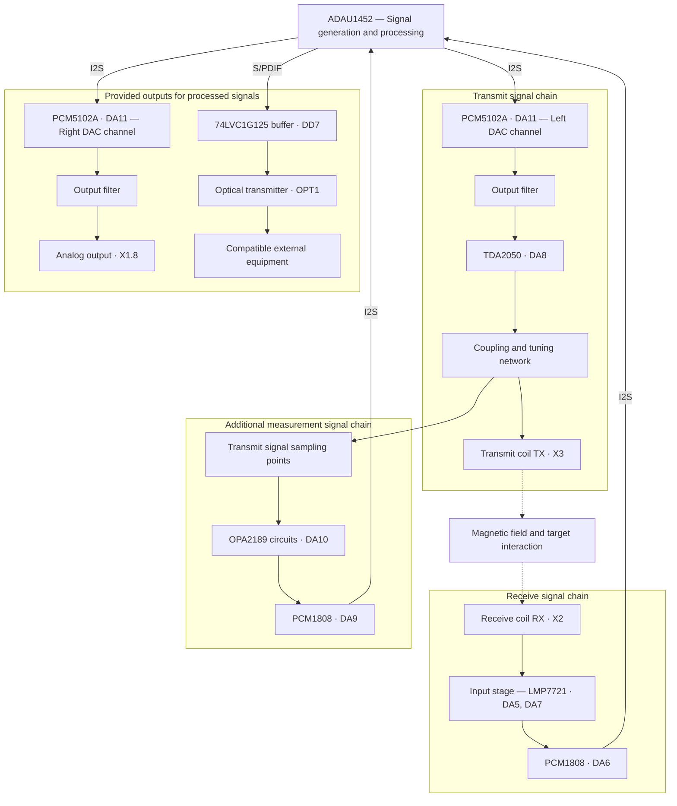

# FerroDSP

[Русский](README.md) | **English**

**An experimental metal detector based on the ADAU1452 audio processor.**

FerroDSP uses an audio DSP to investigate signals from a search coil assembly. Custom electronics, SigmaStudio algorithms and 3D-printable parts form a platform for experimenting with coil excitation, reception and response processing.


*The assembled search coil. Photographs of the internal construction are [below](#prototype-photographs).*

> The project is experimental. The available materials include an assembled prototype and DSP project compilation results; quantitative detection performance still needs to be verified by measurements.

## Contents

- [What makes this project different](#what-makes-this-project-different)
- [Block diagram](#block-diagram)
- [Architecture and capabilities](#architecture-and-capabilities)
- [FerroDSP coils — DD construction](#ferrodsp-coils--dd-construction)
- [Prototype photographs](#prototype-photographs)
- [Project materials](#project-materials)
- [Continuing development with AI](#continuing-development-with-ai)
- [Current status](#current-status)

## What makes this project different

FerroDSP combines several distinctive design choices:

- **An ADAU1452 in the measurement signal chain.** The processor generates and processes the metal detector signals.
- **Algorithms in SigmaStudio.** A block diagram makes it possible to investigate processing and change it on the same hardware.
- **Electronics inside the search coil assembly.** The board and coils form one mechanical assembly.
- **Multiple digitization channels.** The hardware provides inputs from both the receive coil and the transmit signal chain.
- **Further development together with AI.** The project materials can support understanding the device, developing hypotheses and conducting reproducible experiments.

The saved DSP project contains generators, FIR and other filters, Hilbert transforms, adjustable delay, envelope detectors and output signal generation blocks. These provide a basis for studying the amplitude and phase of target responses and ways to represent them as sound.

The project may be useful to builders of homemade metal detectors, electronics enthusiasts, SigmaStudio users and anyone studying digital signal processing on real hardware.

## Block diagram

The diagram shows the main hardware signal paths from the [electrical schematic](схема_плата/схема.pdf). Solid arrows represent electrical signal connections; dashed arrows represent interaction through the magnetic field. Power, protection, clock and control circuits are omitted.



TX and RX are coupled through the magnetic field. The additional measurement chain samples signals at several points in the transmit circuit; the sampling section is shown in simplified form. In the receive chain, OPA2189 (DA4.1) also contributes to generating the reference level.

The left and right DAC channels in the diagram belong to the same DA11 chip. Signal generation and processing take place inside one ADAU1452. The meaning of the output data and the indication method depend on the DSP configuration and the connected equipment.

This is a hardware block diagram, not a map of SigmaStudio block connections or confirmation that every signal path has been tested. The optical interface status is described [separately](#optical-digital-output).

## Architecture and capabilities

### Adjustable digital processing

SigmaStudio allows changes to processing structure, filtering, gain, delays and signal generation. Within the capabilities of the analog hardware and processor, many experiments can be conducted without making a new board.

The graphical representation helps treat the algorithm as a sequence of connected functional blocks and relate changes to the behavior of the search coil assembly.

### Electronics next to the coils

The board is installed directly inside the search coil assembly. This shortens the path of the weak analog signal from the receive coil to the input electronics and offers a basis for reducing the effects of a long analog cable.

The mechanics and electronics were designed together. How much this arrangement improves the stability of a particular unit must be determined by measurements.

### Digitization of receive and reference signals

The schematic uses two PCM1808 ADCs: DA6 handles the receive coil input stage, while DA9 connects to the transmit circuits. This provides a basis for comparing signals and experimenting with reference-based processing.

The actual compensation and target identification capabilities depend on the algorithm and tuning.

### Analog signal chain

The receive signal chain uses LMP7721 and OPA2189; several circuits specify resistors with a tolerance of 0.01%. Linear regulators, supply filtering, decoupling capacitors and protection components are provided. The transmit coil is driven by a TDA2050 amplifier, fed by the PCM5102A DAC.

This provides a developed hardware basis for tuning and measurements. Actual noise, drift and sensitivity also depend on the board, assembly, coils and operating conditions.

### Optical digital output

In the electrical schematic, the processor's S/PDIF output connects to an optical transmitter through a buffer. The saved compiler report contains S/PDIF output blocks.

**The interface is provided in the hardware and DSP project; the available materials contain no results verifying physical optical transmission.** Once checked with a compatible receiver, it could be used to output selected signals, including for recording and analysis. The DSP configuration determines the data content.

### DSP resource headroom

The saved [compilation report](сигма_проект/Ferrodsp_v1_exp2/Ferrodsp_v1_exp2_IC%201/compiler_output.log) dated 7 February 2026 contains these estimates:

| Parameter | Value |
| --- | --- |
| Sampling rate | 96 kHz |
| Cycle utilization | Approximately 39% |
| Program memory used | Approximately 22% |
| Data memory DM0 / DM1 used | Approximately 6% / 3% |
| Compilation result | 0 errors, 0 warnings |

According to this report, the current configuration leaves room to extend the processing. These values apply to the saved build and are compiler estimates; resource use must be checked again after changes.

### Electronics and mechanics in one package

The project includes a schematic, bill of materials, board Gerber files, SigmaStudio project, compilation outputs and prototype photographs. Models of the enclosure and coil formers are available in STL, STEP and M3D. STL is useful for printing, while STEP supports adapting the construction in CAD.

## FerroDSP coils — DD construction

The search coil assembly uses a **DD** configuration. The **TX transmit coil connects to X3**, and the **RX receive coil connects to X2**. RX consists of two halves with a center tap.

### Coil parameters

| Parameter | Transmit TX | Receive RX, L1 | Receive RX, L2 |
| --- | --- | --- | --- |
| Wire diameter | 0.45 mm | 0.15 mm | 0.15 mm |
| Number of turns | 45 | 100 | 100 |
| Resistance | 2.4 Ω | 63 Ω | 67.9 Ω |
| Inductance | 787 µH | 5.495 mH | 6.388 mH |
| Quality factor Q | 16.3 | 4.92 | 5.25 |

These parameters were reported by the author for his unit. The frequency and conditions used to measure inductance and quality factor have not yet been specified. L1 and L2 in this table identify the two RX halves; they are not board component reference designators. Former models are available in the [enclosure directory](корпус/).

### Transmit coil resonance

Two parallel capacitors, **C33 and C34, each 68 nF**, give a total capacitance of **136 nF**. With a TX inductance of **787 µH**, the ideal LC resonant-circuit formula gives:

```text
C = C33 + C34 = 136 nF
f₀ = 1 / (2π√(LC)) ≈ 15 384 Hz ≈ 15.38 kHz
```

The calculation assumes no additional capacitance from **C30**. This is a calculated resonant frequency; the exact measured operating frequency has not yet been specified.

According to the author's observation, the TX voltage at resonance is **approximately 120 V peak-to-peak (Vpp)**. This is the voltage swing, not the RMS value.

### Balancing

Correct balancing affects sensitivity and discrimination — distinguishing metals by their phase response. The method below is the procedure described by the author for his unit:

1. Connect the probes of two oscilloscope channels to the outer RX terminals and both channel ground leads to the center tap.
2. Move RX relative to TX while observing the phase relationship between the two signals.
3. Find a position where the signals are in antiphase.
4. When metal is brought near the assembly, observe an amplitude decrease in one RX half and an increase in the other.

Before connecting, account for the common ground of the oscilloscope channels: the RX center tap must permit connection to instrument ground. Measuring TX voltage requires a probe and connection method rated for that voltage; connecting a ground lead to an arbitrary point in the transmit circuit can short that point to ground.

The balancing method describes the author's practice. Quantitative tuning criteria and sensitivity and discrimination test results have not yet been documented; antiphase signals alone do not verify detection performance.

## Prototype photographs

### Board and coils


*Electronics located directly inside the search coil assembly.*

### Underside and assembly


*Internal construction of the experimental unit.*

## Project materials

| Directory or file | Contents |
| --- | --- |
| [SigmaStudio project](сигма_проект/Ferrodsp_v1_exp2/Ferrodsp_v1_exp2.dspproj) | Original Ferrodsp_v1_exp2 algorithm graph |
| [Compilation outputs](сигма_проект/Ferrodsp_v1_exp2/Ferrodsp_v1_exp2_IC%201/) | Program, parameters and resource report |
| [Electrical schematic](схема_плата/схема.pdf) | Six schematic pages; labels are already in English |
| [Bill of materials](схема_плата/specificationsmd.en.xlsx) | Components and reference designators with English column headings; [Russian original](схема_плата/specificationsmd.xlsx) |
| [Board manufacturing files](схема_плата/FerroDSP_EXP2_V1.zip) | Gerber and drill file archive |
| [Mechanical models](корпус/) | Search coil enclosure and TX/RX formers in STL, STEP and M3D |
| [Photographs](фото/) | Assembled search coil and internal construction |

## Continuing development with AI

### 1. Open the materials

Open the project's root folder as a local project in Codex. Start with the README, schematic and compilation reports, then choose the signal path you want to investigate.

| Source | How to use it |
| --- | --- |
| `схема_плата/схема.pdf` | Inspect visually: extracted text reveals almost none of the connections |
| `схема_плата/specificationsmd.en.xlsx` | Match components and reference designators to the schematic |
| `сигма_проект/Ferrodsp_v1_exp2/Ferrodsp_v1_exp2.dspproj` | Open in SigmaStudio; the saved files relate to version 4.7 |
| `compiler_output.log` in the compilation output directory | Check build results and resource estimates |
| `ParamAddress.dat` in the same directory | Examine parameter addresses |
| `фото/` and `корпус/` | Study assembly, layout and search coil construction |

The `.dspproj` format is binary: reading individual strings from the file does not replace viewing the graph. To analyze a particular chain with AI, provide a screenshot of the relevant SigmaStudio area and the block parameter values. Make changes in the source project and then recompile it; `Program.bin` and the other output files are build results.

### 2. Prepare the first experiment

For example, investigate one parameter of a receive-chain filter. First trace the block's connections in SigmaStudio and confirm its purpose. Work on a project copy, retaining the original for comparison.

Example task for Codex:

```text
Study README.en.md, the electrical schematic and the reports in
сигма_проект/Ferrodsp_v1_exp2/Ferrodsp_v1_exp2_IC 1.

Separate confirmed facts from assumptions. Help prepare an experiment
with one parameter of a receive-chain filter:
which SigmaStudio connections and settings should be shown,
what should be changed, and which measurements should be compared.

For the binary .dspproj, use a screenshot of the relevant area
and the parameter values. Prepare a plan first without changing files.
```

### 3. Change, measure, compare

1. Record the project version, initial settings, target, distance and position relative to the search coil, gain and recording method.
2. Take the baseline measurement. If optical recording is planned, first verify the interface separately with the chosen receiver.
3. Change one parameter, compile the project in SigmaStudio, and check errors and resource use.
4. After loading the project, repeat the measurement under the same conditions. Compare the response, background and repeatability.
5. Save the settings, measurements and a brief conclusion, including cases where no improvement was obtained.

This gives each experiment a clear basis: **hypothesis → one change → measurement → result**. DSP, analog electronics or mechanics can be investigated separately while preserving the shared project context.

Reference: [local projects and chats in Codex](https://learn.chatgpt.com/docs/projects).

## Current status

| Available materials | Still to be documented or verified |
| --- | --- |
| Photographs of the assembled prototype | Repeatable tests in air and in different soils |
| Original SigmaStudio project and a successful saved build | Detection depth and accuracy of metal discrimination |
| Schematic and board manufacturing files | Noise, drift, power consumption and battery life |
| Enclosure and former models, winding parameters and the author's balancing procedure | Complete construction instructions and quantitative balancing criteria |
| Provision for optical S/PDIF | Verification of physical transmission to an external receiver |

The current package does not yet replace a step-by-step assembly, connection, loading and tuning guide. Quantitative comparison with other instruments requires testing under identical conditions.

FerroDSP's value lies in combining custom hardware, adjustable digital processing and materials that make it possible to study the device and develop it using verifiable results.

---

This description was prepared from **Ferrodsp_v1_exp2** materials. Resource estimates come from the saved compilation report dated **7 February 2026**. The coil parameters and balancing description were added on **1 November 2026**, based on the author's account of his unit. No hardware measurements were performed while preparing this README.

## Licenses

Original hardware materials and enclosure models use **CERN-OHL-P-2.0**; the author's DSP settings, software, README and prototype photographs use **MIT**. Scope and third-party exclusions are described in [NOTICE.en.md](NOTICE.en.md). Full license texts: [MIT](LICENSE), [CERN-OHL-P-2.0](LICENSES/CERN-OHL-P-2.0.txt).

## Updating translations

New materials may be published in Russian first. English translations and their source versions are tracked as described in [the translation workflow](docs/TRANSLATION.en.md).
