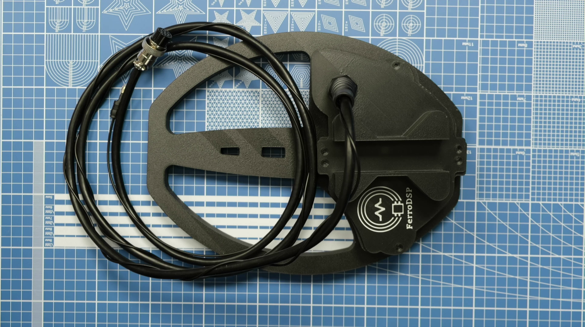
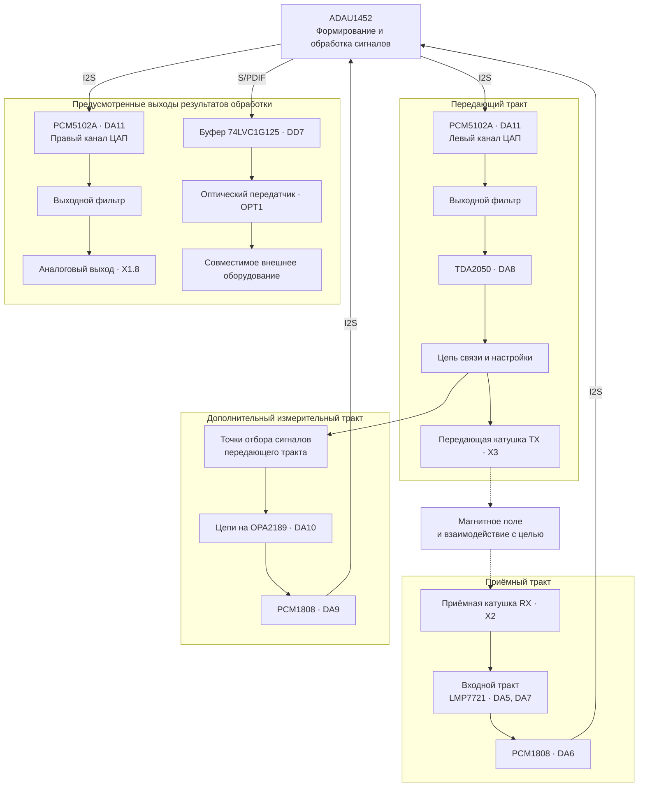
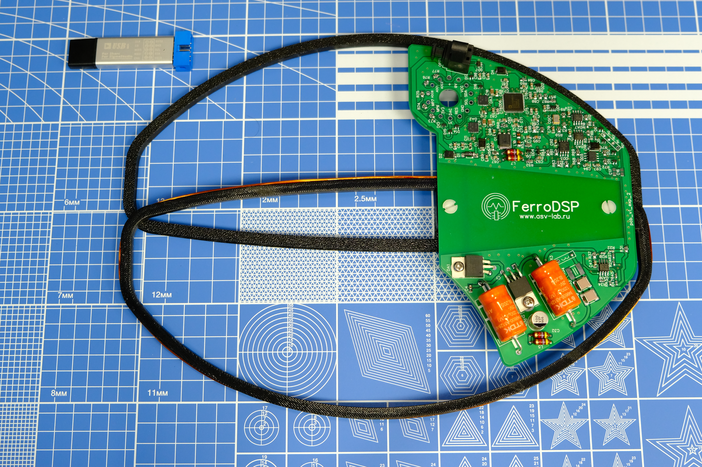
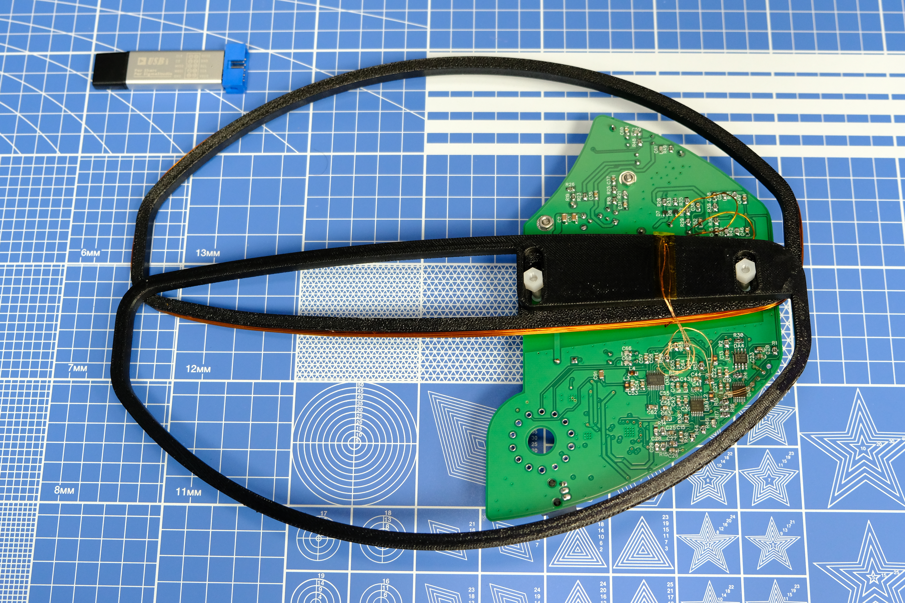

# FerroDSP

[Русский](README.md) | [English](README.en.md)

**Экспериментальный металлоискатель на базе аудиопроцессора ADAU1452.**

FerroDSP использует аудио-DSP для исследования сигналов поискового датчика. Собственная электроника, алгоритмы в SigmaStudio и детали для 3D-печати образуют платформу для экспериментов с возбуждением катушки, приёмом и обработкой отклика.



*Собранный поисковый датчик. Фотографии внутреннего устройства — [ниже](#фотографии-прототипа).*

> Проект находится на экспериментальной стадии. В материалах есть собранный прототип и результаты компиляции DSP-проекта; количественные характеристики поиска ещё предстоит подтвердить измерениями.

## Содержание

- [Чем отличается проект](#чем-отличается-проект)
- [Структурная схема](#структурная-схема)
- [Архитектура и возможности](#архитектура-и-возможности)
- [Катушки FerroDSP — конструкция DD](#катушки-ferrodsp--конструкция-dd)
- [Фотографии прототипа](#фотографии-прототипа)
- [Материалы проекта](#материалы-проекта)
- [Как продолжить разработку с ИИ](#как-продолжить-разработку-с-ии)
- [Текущий статус](#текущий-статус)

## Чем отличается проект

Самобытность FerroDSP складывается из нескольких решений:

- **ADAU1452 в измерительном тракте.** Процессор используется для формирования и обработки сигналов металлоискателя.
- **Алгоритмы в SigmaStudio.** Граф блоков позволяет исследовать обработку и менять её на одной аппаратной основе.
- **Электроника непосредственно в датчике.** Плата и катушки объединены в одной конструкции.
- **Несколько каналов оцифровки.** Предусмотрен приём сигналов как от приёмной катушки, так и от цепей передающего тракта.
- **Продолжение разработки совместно с ИИ.** Материалы проекта можно использовать для разбора устройства, подготовки гипотез и проведения проверяемых экспериментов.

В сохранённом DSP-проекте присутствуют генераторы, FIR-фильтры и фильтры других типов, преобразования Гильберта, регулируемая задержка, детекторы огибающей и блоки формирования выходного сигнала. Это основа для исследования амплитудных и фазовых характеристик отклика и способов его звукового представления.

Проект может быть интересен разработчикам самодельных металлоискателей, радиолюбителям, пользователям SigmaStudio и тем, кто изучает цифровую обработку сигналов на реальном оборудовании.

## Структурная схема

Схема показывает основные аппаратные маршруты по [электрической схеме](схема_плата/схема.pdf). Сплошные стрелки обозначают электрические сигнальные соединения, пунктирные — взаимодействие через магнитное поле. Цепи питания, защиты, тактирования и управления опущены.



TX и RX связаны через магнитное поле. Дополнительный измерительный тракт получает сигналы из нескольких точек передающей цепи; узел отбора на диаграмме показан обобщённо. В приёмном тракте OPA2189 (DA4.1) также участвует в формировании опорного уровня.

Левый и правый каналы ЦАП на диаграмме относятся к одной микросхеме DA11. Формирование и обработка сигналов выполняются внутри одного ADAU1452. Назначение выходных данных и способ индикации зависят от DSP-конфигурации и подключённого оборудования.

Это аппаратная структурная схема, а не карта соединений блоков SigmaStudio или подтверждение работоспособности каждого тракта. Статус оптического интерфейса описан [отдельно](#оптический-цифровой-выход).

## Архитектура и возможности

### Изменяемая цифровая обработка

В SigmaStudio можно менять структуру обработки, фильтрацию, усиление, задержки и формирование сигналов. В пределах возможностей аналогового тракта и процессора многие эксперименты можно проводить без изготовления новой платы.

Графическое представление помогает рассматривать алгоритм как последовательность связанных функциональных блоков и сопоставлять изменения с поведением датчика.

### Электроника рядом с катушками

Плата установлена непосредственно в конструкции поискового датчика. Это сокращает путь слабого аналогового сигнала от приёмной катушки до входной электроники и создаёт предпосылки для уменьшения влияния длинного аналогового кабеля.

Механика и электроника разработаны совместно. Насколько такая компоновка улучшает устойчивость конкретного экземпляра, нужно оценивать измерениями.

### Оцифровка приёмного и опорных сигналов

В схеме используются два АЦП PCM1808: DA6 обслуживает входной тракт приёмной катушки, DA9 подключён к цепям передающего тракта. Это основа для сравнения сигналов и экспериментов с обработкой относительно опорного сигнала.

Конкретные возможности компенсации и распознавания целей зависят от алгоритма и настройки.

### Аналоговый тракт

В приёмном тракте используются LMP7721 и OPA2189; в ряде цепей указаны резисторы с допуском 0,01%. Предусмотрены линейные стабилизаторы, фильтрация питания, развязывающие конденсаторы и защитные элементы. Передающая катушка имеет усилительный тракт на TDA2050, сигнал для которого поступает с ЦАП PCM5102A.

Это проработанная основа для настройки и измерений. Фактические шумы, дрейф и чувствительность определяются также платой, монтажом, катушками и условиями эксплуатации.

### Оптический цифровой выход

В электрической схеме выход S/PDIF процессора подключён через буфер к оптическому передатчику. В сохранённом отчёте компилятора присутствуют блоки вывода S/PDIF.

**Интерфейс предусмотрен конструкцией и DSP-проектом; результатов проверки физической оптической передачи в имеющихся материалах нет.** После проверки с совместимым приёмником он может использоваться для вывода выбранных сигналов, в том числе для записи и анализа. Состав данных определяется DSP-конфигурацией.

### Запас ресурсов DSP

Сохранённый [отчёт компиляции](сигма_проект/Ferrodsp_v1_exp2/Ferrodsp_v1_exp2_IC%201/compiler_output.log) от 7 февраля 2026 года содержит следующие оценки:

| Параметр | Значение |
| --- | --- |
| Частота дискретизации | 96 кГц |
| Загрузка по циклам | Около 39% |
| Занято памяти программы | Около 22% |
| Занято памяти данных DM0 / DM1 | Около 6% / 3% |
| Результат компиляции | 0 ошибок, 0 предупреждений |

По этому отчёту текущая конфигурация оставляет запас для развития обработки. Значения относятся к сохранённой сборке и являются оценкой компилятора; расход ресурсов после доработок нужно проверять заново.

### Электроника и механика в одном комплекте

В проекте есть схема, перечень компонентов, Gerber-файлы платы, проект SigmaStudio, результаты компиляции и фотографии прототипа. Модели корпуса и каркасов катушек представлены в STL, STEP и M3D. STL пригодится для печати, STEP — для адаптации конструкции в CAD.

## Катушки FerroDSP — конструкция DD

Поисковый датчик выполнен по конструкции **DD**. Передающая катушка **TX подключается к X3**, приёмная **RX — к X2**. RX состоит из двух половин со средним отводом.

### Параметры катушек

| Параметр | Передающая TX | Приёмная RX, L1 | Приёмная RX, L2 |
| --- | --- | --- | --- |
| Диаметр провода | 0,45 мм | 0,15 мм | 0,15 мм |
| Число витков | 45 | 100 | 100 |
| Сопротивление | 2,4 Ом | 63 Ом | 67,9 Ом |
| Индуктивность | 787 мкГн | 5,495 мГн | 6,388 мГн |
| Добротность Q | 16,3 | 4,92 | 5,25 |

Параметры приведены со слов автора для его экземпляра. Частота и условия измерения индуктивности и добротности пока не указаны. Обозначения L1 и L2 в этой таблице относятся к половинам RX и не являются позиционными обозначениями компонентов платы. Модели каркасов доступны в каталоге [корпус](корпус/).

### Резонанс передающей катушки

Два параллельных конденсатора **C33 и C34 по 68 нФ** дают общую ёмкость **136 нФ**. При индуктивности TX **787 мкГн** расчёт по формуле идеального LC-контура даёт:

```text
C = C33 + C34 = 136 нФ
f₀ = 1 / (2π√(LC)) ≈ 15 384 Гц ≈ 15,38 кГц
```

Расчёт предполагает отсутствие дополнительной ёмкости **C30**. Это расчётная частота резонанса; точная измеренная рабочая частота пока не указана.

По наблюдению автора, напряжение на TX в резонансе составляет **около 120 В от пика до пика (Vpp)**. Это размах напряжения, а не действующее значение.

### Балансировка

Правильная балансировка влияет на чувствительность и дискриминацию — различение металлов по фазовому отклику. Ниже записан способ, описанный автором для своего экземпляра:

1. Щупы двух каналов осциллографа подключают к крайним выводам RX, общие провода каналов — к среднему отводу.
2. RX перемещают относительно TX, наблюдая фазовое соотношение двух сигналов.
3. Ищут положение с противофазными сигналами.
4. При поднесении металла наблюдают уменьшение амплитуды в одной половине RX и увеличение в другой.

Перед подключением следует учитывать общую землю каналов осциллографа: средний отвод RX должен допускать соединение с землёй прибора. Для измерения напряжения TX нужны щуп и способ подключения, рассчитанные на соответствующее напряжение; подключение общей земли к произвольной точке передающего контура может замкнуть её на землю.

Способ балансировки приведён как описание авторской практики. Количественные критерии настройки и результаты проверки чувствительности и дискриминации пока не задокументированы; наличие противофазных сигналов само по себе не подтверждает характеристики обнаружения.

## Фотографии прототипа

### Плата и катушки



*Размещение электроники непосредственно в поисковом датчике.*

### Обратная сторона и монтаж



*Внутреннее устройство экспериментального экземпляра.*

## Материалы проекта

| Каталог или файл | Содержание |
| --- | --- |
| [Проект SigmaStudio](сигма_проект/Ferrodsp_v1_exp2/Ferrodsp_v1_exp2.dspproj) | Исходный граф алгоритма Ferrodsp_v1_exp2 |
| [Результаты компиляции](сигма_проект/Ferrodsp_v1_exp2/Ferrodsp_v1_exp2_IC%201/) | Программа, параметры и отчёт о ресурсах |
| [Электрическая схема](схема_плата/схема.pdf) | Шесть страниц схемы устройства |
| [Перечень компонентов](схема_плата/specificationsmd.xlsx) | Компоненты и обозначения |
| [Производственные файлы платы](схема_плата/FerroDSP_EXP2_V1.zip) | Архив Gerber и файлов сверления |
| [Механика](корпус/) | Корпус датчика и каркасы TX/RX в STL, STEP и M3D |
| [Фотографии](фото/) | Собранный датчик и внутреннее устройство |

## Как продолжить разработку с ИИ

Один из главных акцентов FerroDSP — совместная работа человека и ИИ над реальным устройством. Материалы проекта дают контекст для обсуждения схемы, алгоритмов и механики. ИИ может помогать объяснять устройство, готовить расчёты, скрипты анализа и документацию; качество изменений оценивается по результатам экспериментов.

### 1. Откройте материалы

Откройте корневую папку проекта как локальный проект в Codex. Начните с README, схемы и отчётов компиляции, затем выберите интересующий тракт.

| Источник | Как использовать |
| --- | --- |
| `схема_плата/схема.pdf` | Рассматривать визуально: извлечение текста почти не раскрывает соединения |
| `схема_плата/specificationsmd.xlsx` | Сопоставлять компоненты и обозначения со схемой |
| `сигма_проект/Ferrodsp_v1_exp2/Ferrodsp_v1_exp2.dspproj` | Открыть в SigmaStudio; сохранённые файлы относятся к версии 4.7 |
| `compiler_output.log` в каталоге результатов компиляции | Проверять результат сборки и оценку ресурсов |
| `ParamAddress.dat` в том же каталоге | Изучать адреса параметров |
| `фото/` и `корпус/` | Разбирать монтаж, компоновку и конструкцию датчика |

Формат `.dspproj` двоичный: чтение отдельных строк из файла не заменяет просмотра графа. Для разбора конкретной цепочки с ИИ предоставьте снимок нужного участка из SigmaStudio и значения параметров блоков. Изменения вносите в исходный проект, затем компилируйте его заново; `Program.bin` и остальные выходные файлы относятся к результатам сборки.

### 2. Подготовьте первый эксперимент

Например, исследуйте один параметр фильтра приёмного тракта. Сначала проследите соединения блока в SigmaStudio и убедитесь в его назначении. Работайте с копией проекта, сохранив исходный вариант для сравнения.

Пример задания для Codex:

```text
Изучи README.md, электрическую схему и отчёты из каталога
сигма_проект/Ferrodsp_v1_exp2/Ferrodsp_v1_exp2_IC 1.

Раздели подтверждённые факты и предположения. Помоги подготовить
эксперимент с одним параметром фильтра приёмного тракта:
какие соединения и настройки показать из SigmaStudio,
что изменить и какие измерения сравнить.

Для двоичного .dspproj используй снимок нужного участка
и значения параметров. Сначала подготовь план без изменения файлов.
```

### 3. Измените, измерьте, сравните

1. Зафиксируйте версию проекта, исходные настройки, цель, расстояние и положение относительно датчика, усиление и способ регистрации результата.
2. Выполните исходное измерение. Если планируется оптическая запись, сначала отдельно проверьте интерфейс с выбранным приёмником.
3. Измените один параметр, скомпилируйте проект в SigmaStudio и проверьте ошибки и расход ресурсов.
4. После загрузки повторите измерение в тех же условиях. Сравните отклик, фон и повторяемость.
5. Сохраните настройки, измерения и краткий вывод, включая случаи, когда улучшения не получилось.

Так каждый эксперимент получает понятную основу: **гипотеза → одно изменение → измерение → результат**. Можно отдельно заниматься DSP, аналоговой частью или механикой, сохраняя общий контекст проекта.

Справка: [локальные проекты и чаты в Codex](https://learn.chatgpt.com/docs/projects).

## Текущий статус

| Что есть в материалах | Что ещё предстоит документировать или проверить |
| --- | --- |
| Фотографии собранного прототипа | Повторяемые испытания в воздухе и на разных грунтах |
| Исходный проект SigmaStudio и успешная сохранённая сборка | Глубина обнаружения и точность различения металлов |
| Схема и производственные файлы платы | Шумы, дрейф, энергопотребление и автономность |
| Модели корпуса и каркасов, параметры намотки и описание авторского способа балансировки | Полная инструкция по изготовлению и количественные критерии балансировки |
| Предусмотренный оптический S/PDIF | Проверка физической передачи на внешний приёмник |

Имеющийся комплект пока не заменяет пошагового руководства по сборке, подключению, загрузке и настройке. Для количественного сравнения с другими приборами нужны испытания в одинаковых условиях.

Ценность FerroDSP — в сочетании собственной аппаратуры, изменяемой цифровой обработки и материалов, позволяющих изучать устройство и развивать его на основе проверяемых результатов.

---

Описание подготовлено по материалам версии **Ferrodsp_v1_exp2**. Оценки ресурсов взяты из сохранённого отчёта компиляции от **7 февраля 2026 года**. Параметры катушек и описание балансировки добавлены **1 ноября 2026 года** со слов автора для его экземпляра. Аппаратные измерения при подготовке README не проводились.


## Лицензии

Оригинальные аппаратные материалы и модели корпуса — **CERN-OHL-P-2.0**; авторские настройки DSP, программный код, README и фотографии прототипа — **MIT**. Область действия и исключения для сторонних материалов описаны в [NOTICE.md](NOTICE.md). Полные тексты: [MIT](LICENSE), [CERN-OHL-P-2.0](LICENSES/CERN-OHL-P-2.0.txt).
