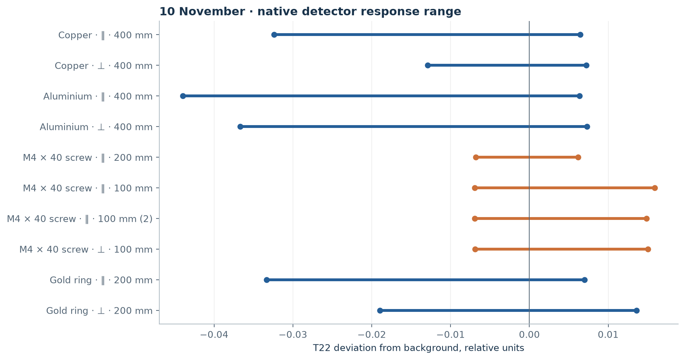
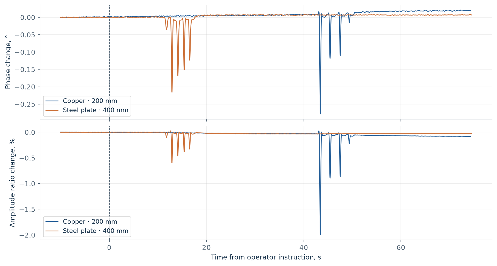
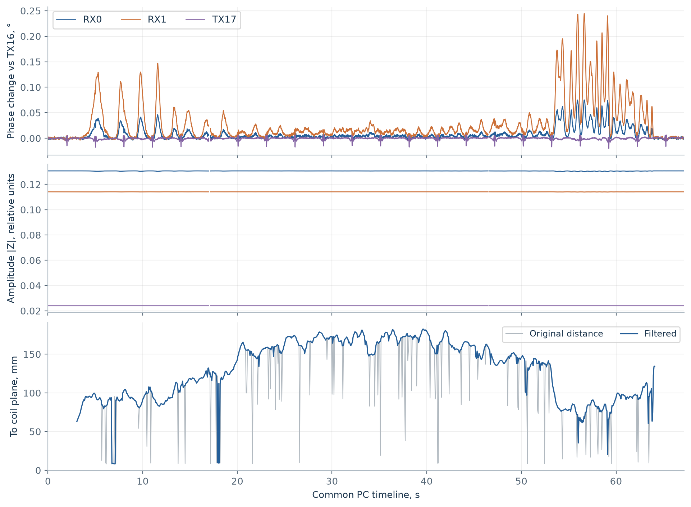

# FerroDSP bench measurements: 10–11 November 2026

[Русский](README.md) | [English](README.en.md)

[PDF report, 6 pages](FerroDSP-bench-2026-11-10_11.en.pdf) · [MP4 demonstration](https://media.neuroandriyanov.com/demonstration_ferrodsp_lab.mp4) · [Laboratory application](../../../pc_app/QUICKSTART.en.md)

The report describes experiments on one prototype. It is not a specification of detection depth, size estimation accuracy or metal classification. Conditions, units, label corrections and limitations are documented in the PDF.

## Observations



T22 is a relative balance-detector output, not degrees. Segments show background-corrected minima and maxima, not confidence intervals. ∥ / ⊥ indicate the target plane relative to the coil; for the screw they indicate its axis. One of 11 recordings has unconfirmed distance and orientation and is excluded from the graph. The operator corrected `screw_perpendicular_02` to a parallel axis at 100 mm.



This is RX0/RX1 interchannel phase, not RX/TX phase. Targets were at different distances: copper approximately 200 mm, steel plate approximately 400 mm. Both materials produced negative excursions. RX and TX were recorded in separate passes on 10 November and cannot be combined into simultaneous observations.



11 November: a 21 × 3 mm ring with its plane parallel to the coil; D415 at 640 × 480 and 15 fps. Original and filtered distances, I/Q, quality masks and timestamps are retained. Distance refers to the nearest visible foreground surface, which may be a hand or holder. A common PC timeline does not establish hardware synchronization of camera exposures and audio.

## Data and reproduction

| File | Contents |
| --- | --- |
| [phase-summary.json](data/phase-summary.json) | 11 native detector recordings, normalized labels, background statistics and extrema |
| [optical-summary.json](data/optical-summary.json) | 16 direct RX / TX optical recordings, distances and response ranges |
| `data/*-features.npz` | Direct-trial time series: `t`, `phase_deg`, `ratio_percent`, `amplitude_percent`, `base` / `active` masks |
| [transport-validation.json](data/transport-validation.json) | Prescribed I/Q transport checks and background recordings |
| `data/transport-background.npz` | 60 s background, I/Q and quality masks |
| [blind-labels.json](data/blind-labels.json) | Revealed target identities and blind-trial protocol deviations |
| `data/blind*-prediction.json` | Unmodified predictions saved before target reveal |
| [lab-sessions.json](data/lab-sessions.json) | Two recordings from 11 November, settings, statistics and original-file manifests |
| `data/20261111-*.npz` | Derived `analysis.h5` arrays: `signals`, `frames`, `aligned_frames` groups separated by double underscores |
| [source-provenance.json](data/source-provenance.json) | Relative local source paths, file sizes and SHA-256 hashes |
| [build_report.py](build_report.py) | Rebuilds bilingual plots and PDFs from the published derivatives |

Original multi-gigabyte WAV, RGB/Z16 and working logs remain in the local archive. These NPZ files reproduce the plots but do not replace raw samples when testing a different demodulator. `NaN` and invalidity masks are preserved. Signal analysis must combine `valid`, `timestamp_valid` and, for phase, `phase_valid`; geometry requires `geometry_valid` and `timestamp_valid`. The original `phase_valid` alone does not test timing errors or SNR.

```sh
python -m pip install numpy matplotlib reportlab
python docs/measurements/2026-11-10_11/build_report.py
```

The script writes plots to `figures` and PDFs to this directory and `output/pdf`. It locates the repository from its own path. NumPy alone reads the NPZ files; `allow_pickle` is unnecessary. Numeric traces and photographs have not been retouched.

## Equipment and sources

- DSP: [Analog Devices ADAU1452](https://www.analog.com/en/products/adau1452.html), SigmaStudio 4.7; USBi configuration interface (the particular adapter's manufacturer is unconfirmed).
- Color/depth camera: [Intel RealSense D415 manufacturer brief](https://simplecore.intel.com/realsensehub/wp-content/uploads/sites/63/D415_ProductBrief.pdf). It connects directly over USB 3; there is no separate video capture card.
- Optical audio capture: [Creative Sound Blaster G3](https://uk.creative.com/p/sound-blaster/sound-blaster-g3). WASAPI capture at 96 kHz, stereo PCM24. PCM24 is a container format: Creative separately specifies 16-bit Optical In at 48/96 kHz; effective signal-chain resolution was not measured here.
- PCM1808 ADCs, PCM5102A DAC, LMP7721/OPA2189 amplifiers: Texas Instruments; TDA2050 TX amplifier: STMicroelectronics. Connections are documented in the [electrical schematic](../../../схема_плата/схема.pdf), [English hardware annotations](../../HARDWARE-ANNOTATIONS.en.md) and [transport description](../../../pc_app/resources/transport-protocol.json).

The four-channel project executes DSP at 96 kHz; the protocol's ADC serial clock configuration field is 48 kHz. Neither value should be confused with the PC I/Q output rate of 100 sets/s.

## Direction for further trials

Retain four complex channels; evaluate RX relative to TX16 and additionally the ratio of the two TX signals. Separate quality checks and background compensation from classification. Evaluate whole passes and unseen objects rather than neighboring frames from the same recording. Depth and size estimation require independent measurements of the target's own position and controlled orientation.
