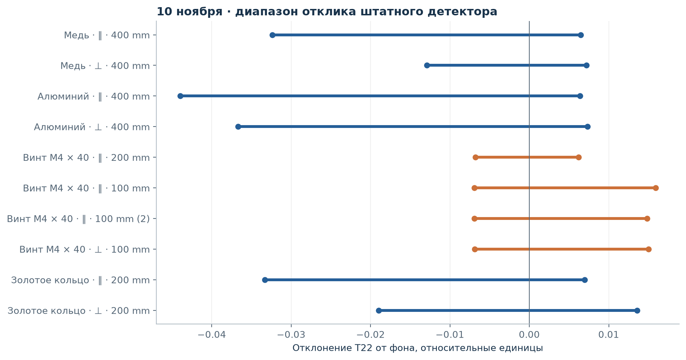
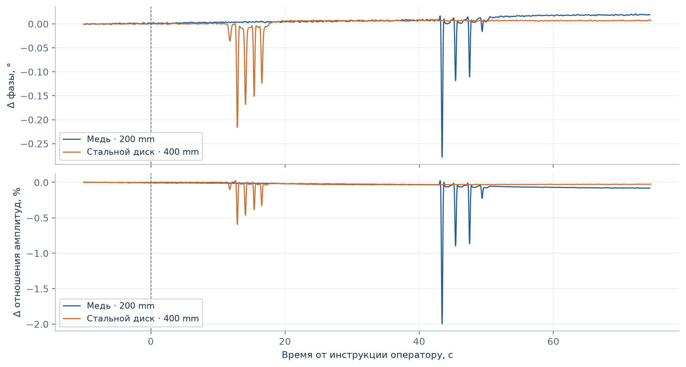
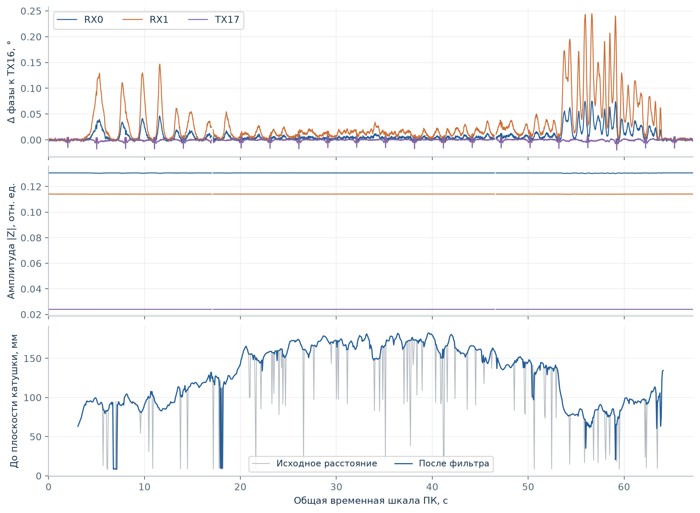

# Стендовые измерения FerroDSP: 10–11 ноября 2026

[Русский](README.md) | [English](README.en.md)

[Отчёт PDF, 6 страниц](FerroDSP-bench-2026-11-10_11.ru.pdf) · [Демонстрация MP4](https://media.neuroandriyanov.com/demonstration_ferrodsp_lab.mp4) · [Программа лаборатории](../../../pc_app/README.md)

Отчёт описывает опыты на одном экспериментальном экземпляре. Он не является спецификацией глубины поиска, точности определения размера или классификации металлов. Условия, единицы, исправления разметки и ограничения приведены в PDF.

## Наблюдения



T22 — относительный выход балансного детектора, не градусы. Отрезки — минимум и максимум после коррекции фона, не доверительные интервалы. ∥ / ⊥ обозначают плоскость образца относительно катушки, для винта — ось. Из 11 записей одна имеет неподтверждённые расстояние и ориентацию и исключена из графика. `screw_perpendicular_02` исправлена по уточнению оператора на параллельную ось, 100 мм.



Это взаимная фаза RX0/RX1, не RX/TX. Образцы находились на разных расстояниях: медь около 200 мм, стальной диск около 400 мм. Отрицательные отклонения встречаются для обоих материалов. RX и TX 10 ноября записывались в отдельных проходах; объединять их в синхронные наблюдения нельзя.



11 ноября: кольцо 21 × 3 мм, плоскость параллельна катушке, D415 640 × 480 при 15 кадр/с. Сохраняются исходные и отфильтрованные расстояния, I/Q, маски качества и временные метки. Расстояние относится к ближайшей видимой поверхности перед фоном: ею может быть рука или держатель. Общая шкала ПК не означает аппаратной синхронности экспозиций камеры и аудио.

## Данные и воспроизведение

| Файл | Содержание |
| --- | --- |
| [phase-summary.json](data/phase-summary.json) | 11 записей штатного детектора, нормализованная разметка, статистики фона и экстремумы |
| [optical-summary.json](data/optical-summary.json) | 16 прямых оптических записей RX / TX, расстояния и диапазоны отклика |
| `data/*-features.npz` | Временные ряды прямых опытов: `t`, `phase_deg`, `ratio_percent`, `amplitude_percent`, маски `base` / `active` |
| [transport-validation.json](data/transport-validation.json) | Проверка передачи заданных I/Q и фоновые записи |
| `data/transport-background.npz` | 60-секундный фон, I/Q и маски качества |
| [blind-labels.json](data/blind-labels.json) | Раскрытые образцы и отклонения от протокола слепых опытов |
| `data/blind*-prediction.json` | Неизменённые предсказания, сохранённые до раскрытия образца |
| [lab-sessions.json](data/lab-sessions.json) | Две записи 11 ноября, параметры, статистики, манифесты исходных файлов |
| `data/20261111-*.npz` | Производные массивы `analysis.h5`: группы `signals`, `frames`, `aligned_frames` разделены двойным подчёркиванием |
| [source-provenance.json](data/source-provenance.json) | Относительные пути локальных источников, размеры и SHA-256 |
| [build_report.py](build_report.py) | Перестроение графиков и PDF на обоих языках из опубликованных производных |

Исходные многогигабайтные WAV, RGB/Z16 и рабочие журналы остаются в локальном архиве. Эти NPZ воспроизводят графики, но не заменяют исходные отсчёты для проверки другого демодулятора. `NaN` и маски недостоверности сохранены. При анализе сигналов нужно объединять `valid`, `timestamp_valid` и, для фаз, `phase_valid`; для геометрии — `geometry_valid` и `timestamp_valid`. Исходный `phase_valid` сам по себе не проверяет временные ошибки или SNR.

```sh
python -m pip install numpy matplotlib reportlab
python docs/measurements/2026-11-10_11/build_report.py
```

Скрипт создаёт графики в `figures`, PDF в этом каталоге и `output/pdf`. Путь к репозиторию определяется по расположению скрипта. Для просмотра NPZ достаточно NumPy; `allow_pickle` не нужен. Числовые ряды и фотографии не ретушировались.

## Оборудование и источники

- DSP: [Analog Devices ADAU1452](https://www.analog.com/en/products/adau1452.html), SigmaStudio 4.7; интерфейс настройки USBi (производитель конкретного адаптера не установлен).
- Камера цвета и глубины: [Intel RealSense D415, описание производителя](https://simplecore.intel.com/realsensehub/wp-content/uploads/sites/63/D415_ProductBrief.pdf). Она подключена непосредственно по USB 3, отдельной карты видеозахвата нет.
- Оптический аудиозахват: [Creative Sound Blaster G3](https://uk.creative.com/p/sound-blaster/sound-blaster-g3). Запись WASAPI 96 кГц, стерео PCM24. PCM24 — формат контейнера: спецификация Creative отдельно указывает для Optical In 16 бит при 48/96 кГц; эффективная разрядность тракта здесь не измерена.
- АЦП PCM1808, ЦАП PCM5102A, ОУ LMP7721/OPA2189: Texas Instruments; усилитель TX TDA2050: STMicroelectronics. Соединения — в [электрической схеме](../../../схема_плата/схема.pdf) и [описании транспорта](../../../pc_app/resources/transport-protocol.json).

В четырёхканальном проекте частота выполнения DSP 96 кГц; поле конфигурации последовательного тактирования АЦП в протоколе — 48 кГц. Эти значения не следует смешивать с частотой выдачи оценок I/Q на ПК (100 комплектов/с).

## Вывод для следующих опытов

Сохранять четыре комплексных канала; оценивать RX относительно TX16 и дополнительно отношение двух TX-сигналов. Отделять контроль качества и компенсацию фона от классификатора. Проверять результат по целым проходам и новым предметам, а не по соседним кадрам той же записи. Для оценки глубины и размера нужны независимые измерения положения самого образца и контролируемая ориентация.
